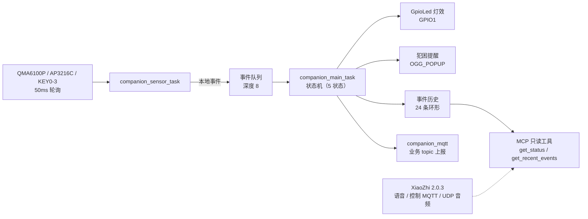

# Companion 桌面情感陪伴终端


基于 ESP32-S3、FreeRTOS 与 XiaoZhi 2.0.3 的桌面情感陪伴设备。设备通过 QMA6100P、AP3216C 和按键感知用户行为，由本地状态机驱动 LED 与定时提醒，并通过 XiaoZhi 完成语音对话与只读 MCP 状态查询。

> **当前状态（2026-10-23）**：阶段二收尾，功能冻结。
> 最新验收固件：`xiaozhi_concurrency_fix_20261023.bin`，2,748,256 字节，SHA-256 `237F6E753C34158A7488DBE38ACCC9CE82CA62DE52C381874AB32D4A224020CF`（固件与日志保留在本地 `backups/`，不随仓库提交）。
> 本轮 MQTT 业务联调结论：现有 XiaoZhi Broker 认证与业务 topic 订阅可用，但发布业务 topic 后 Broker 立即断开；已完成设备侧实现与熔断保护，设备已回滚到稳定固件。最新业务构建：`xiaozhi_mqtt_circuit_breaker2_20261023.bin`，2,756,800 字节，SHA-256 `E9000377BF8FB8E46934254E7AF126A65B663960E16B1934CE5E9D2A4785CB38`（未运行）。
> **重要说明**：本工作区是“项目资料 + 自研模块 + 交付补丁”仓库，不是完整的 XiaoZhi 固件源码仓库。当前产品固件基于独立的 XiaoZhi 2.0.3 源码树，应用 `patches/` 中的补丁构建；工作区根目录的 `main/` 与 `components/` 是早期自研原型，仅作参考。

## 亮点

- **事件抽象而非情绪判定**：传感器读数先转成“拿起、摇晃、手靠近、按键、长时间无互动”等本地事件，由状态机决定灯效与提醒，不直接把读数当作情绪结论。
- **本地闭环**：网络断开时，传感器采集、状态机与 LED 灯效仍独立运行；语音能力由云端 XiaoZhi 补充，而不是替代本地逻辑。
- **只读 MCP 查询**：`self.companion.get_status`、`self.companion.get_recent_events` 让语音端可以问“现在状态如何”，不暴露写操作。
- **业务 MQTT 与语音通道解耦**：设备侧独立 `esp_mqtt_client` 上报事件/状态，默认关闭联调，并带发布熔断保护，避免业务通道故障拖垮语音链路。
- **可验证的交付**：98 项主机测试（C 82 / C++ 5 / MQTT 协议 11）、云端场景引擎 36 项、SmartGuard MCP 15 项测试通过。
- **诚实的能力边界**：未验证项（扬声器人耳出声、真实 AI 服务、MCP 外部调用）在文中明确标注，不把“注册成功”写成“端到端通过”。

## 目录

- [1. 项目简介](#1-项目简介)
- [2. 主要硬件](#2-主要硬件)
- [3. 软件架构](#3-软件架构)
- [4. 已实现功能](#4-已实现功能)
- [5. 状态机与交互](#5-状态机与交互)
- [6. XiaoZhi 与 MCP](#6-xiaozhi-与-mcp)
- [7. 构建环境](#7-构建环境)
- [8. 测试](#8-测试)
- [9. 配置与安全](#9-配置与安全)
- [10. 已知限制](#10-已知限制)
- [11. 目录结构](#11-目录结构)
- [12. 后续规划](#12-后续规划)
- [13. 许可证与第三方代码](#13-许可证与第三方代码)
- [快速开始](#快速开始)
- [文档索引](#文档索引)

## 1. 项目简介

面向书桌、床头、工位等长时间陪伴场景。设备不把传感器读数直接当作情绪结论，而是把“拿起、摇晃、手靠近、按键、长时间无互动”转化为本地事件，由状态机决定灯效和提醒；语音对话由 XiaoZhi 云端完成。

## 2. 主要硬件

| 部件 | 型号/接口 | 用途 |
|---|---|---|
| 主控 | ESP32-S3（正点原子 DNESP32-S3 V1.4） | 采集、状态机、语音、网络 |
| 音频 | ES8388 + I2S + MD8002A 功放 | 语音播放与提醒 |
| 运动 | QMA6100P（I2C 0x12） | 拿起/摇晃识别 |
| 光照/接近 | AP3216C（I2C 0x1E） | ALS/PS 采集 |
| IO 扩展 | XL9555（I2C 0x20） | KEY0–3、功放使能 |
| 指示灯 | GPIO1 普通红色 LED，低电平点亮 | 状态灯效 |
| 按键 | KEY0–KEY3（XL9555 PORT1 bit4–7） | 本地交互 |

## 3. 软件架构



- 产品固件主体：XiaoZhi 2.0.3 + `main/companion/` 自研模块。
- 本地任务与 XiaoZhi 语音任务解耦；网络断开时本地采集、状态机、LED 仍可运行。
- 传感器/按键数据由设备侧 `companion_mqtt` 模块按事件/状态发布到可配置业务 topic；默认关闭联调，需 broker 授权相应 topic。XiaoZhi 语音控制仍走原有 MQTT topic，音频走 UDP。

## 4. 已实现功能

### 4.1 已实现并通过测试/实机验证

- QMA6100P 初始化、周期读取、拿起/摇晃识别。
- AP3216C ALS/PS 读取、阈值与去抖；手靠近触发“被关注”。
- KEY0–KEY3 扫描与去抖；任一按键产生 `EVT_KEY_PRESSED`。
- 5 状态机：待机、被关注、互动中、犯困、报警（报警状态当前无生产者，见限制）。
- 事件队列、事件历史（24 条）、状态机快照。
- GPIO1 红灯：待机约 1 秒慢闪，拿起/摇晃/按键约 200ms 快闪，30 秒回慢闪。
- 60 分钟犯困定时、提醒请求与 30 秒×3 次重试；提醒播放路径已执行。
- MCP 只读工具 `self.companion.get_status`、`self.companion.get_recent_events` 注册成功。
- XiaoZhi 语音对话、Wi-Fi/MQTT 连接。
- 主机测试：C 82 项、C++ 5 项、MQTT 命令协议 11 项，共 98 项通过。

### 4.2 部分验证

- 60 分钟提醒：状态迁移、播放请求、codec 打开已验证；**实际扬声器出声未由人耳确认**。
- MQTT：注册已验证；**外部 `tools/call` 未验证**。
- 设备侧 MQTT 业务上报/下行：已通过独立 1884 broker 真实联调，状态、事件上行与 `noop`/`request_status` 下行均实测通过。
- 断线重连：业务 broker 停止/重启后自动重连并重新订阅已实测；**小智语音链路在故障窗口内未做语音交互验证**。
- 云端消费者：规则引擎、上下文、命令安全策略已实现并通过 36 项单元测试；**真实 AI 服务未配置、未验证**。
- SmartGuard MCP 只读服务：真实小智接入点连接、工具发现和语音端调用已实测通过（`get_smartguard_status` 与 `get_recent_smartguard_events`）；本地 15 项 MCP 测试通过。

### 4.3 尚未实现

- 真实 AI 服务接入（当前只有规则引擎与本地模拟 Provider 验证）。
- 设备端 `play_prompt` 语音下发（当前明确拒绝）。
- 报警状态的触发源（当前不可达）。

### 4.4 明确不要误解

- codec 初始化成功 ≠ 扬声器已确认出声。
- MCP 工具注册成功 ≠ 云端已调用。
- 设备侧 MCP 与 `cloud/smartguard_mcp.py` 是两套独立服务；两者均已分别实测，但能力范围不同。
- MQTT 连接成功 ≠ 传感器数据已被 broker/云端接收；当前独立业务通道已实测收到状态与事件。
- `engine: ai` 只有在真实模型返回并通过校验后才出现；规则降级始终标记 `engine: rules`。
- 模拟 Provider 的通过结果不等于真实 AI 已验证。
- 断线重连已做业务 broker 故障隔离测试；小智语音通道未在故障窗口内实测。
- 原始 PS 值不是厘米距离，未经标定。
- ALS 原始值不是 lux。

## 5. 状态机与交互

| 状态 | 触发 | LED | 退出 |
|---|---|---|---|
| 待机 | 上电/30s 无操作 | 约 1s 慢闪 | 拿起/摇晃/手靠近/按键/语音开始 |
| 被关注 | 拿起/摇晃/手靠近/按键 | 约 200ms 快闪 | 30s 无新动作回待机；语音开始进互动 |
| 互动中 | XiaoZhi 语音开始 | 常亮（单色红灯亮度） | 语音结束进被关注 |
| 犯困 | 待机满 60 分钟 | 慢闪 | 按键/拿起/摇晃/手靠近/语音开始 |
| 报警 | 预留 | 急促闪 | 当前无事件生产者，不可达 |

事件历史记录类型、uptime、ALS、PS、数据有效性；最新事件在前，容量 24。按键事件只携带事件类型，不携带键号；原始 PORT1 位图仅出现在日志。

## 6. XiaoZhi 与 MCP

- XiaoZhi 负责语音唤醒、云端对话、TTS/STT 与音频通道。
- MCP 工具是只读的本地状态/历史查询：
  - `self.companion.get_status`：状态、计时、ALS/PS/加速度、传感器有效性、事件累计、LED 模式等。
  - `self.companion.get_recent_events`：最近最多 24 条事件，`limit` 1–24。
- MCP 调用由云端/客户端发起；没有外部客户端证据时，不能宣称端到端通过。
- MQTT 是 XiaoZhi 控制通道；业务遥测使用独立 `esp_mqtt_client` 和独立 broker，默认 topic 为 `companion/<device_id>/event|status|command`，需 broker 授权。
- 设备侧下行只接受 `request_status`、`play_chime`、`noop`；`play_prompt` 等未实现动作会被拒绝。
- 云端消费者位于 `cloud/companion_consumer.py`，事件/状态上下文与安全策略位于 `cloud/companion_ai.py`。

详见 `docs/MQTT_CLOUD_AI_AUDIT.md`。

## 7. 构建环境

- ESP-IDF v6.1（ESP32-S3 目标）
- Python 3.12、CMake、Ninja、Xtensa GCC（随 ESP-IDF）
- 正点原子 DNESP32-S3 V1.4

### 7.1 产品固件（推荐）

完整产品固件源码为 XiaoZhi 2.0.3 独立源码树。将 `patches/` 中的补丁按以下顺序应用：

1. `companion_fixes_20261022.patch`
2. `companion_p1_led_key_20261022.patch`
3. `companion_p2_timer_history_20261022.patch`
4. `companion_gpio_led_fix_20261023.patch`
5. `companion_concurrency_fix_20261023.patch`

```bash
git -c core.autocrlf=false apply <patch>
idf.py -B build_companion build
idf.py -p <PORT> app-flash   # 仅应用区；不要 erase-flash
```

> 上述补丁链已在当前交付树验证，但**完整干净 XiaoZhi 树的一次性重建需在发布前再执行**。烧录前确认端口、MAC、分区布局和回滚固件。

### 7.2 早期自研原型

工作区根目录的 `main/`、`components/` 与顶层 `CMakeLists.txt` 是早期原型，可用 `tools/build.ps1` 或根目录 `idf.py build` 构建；它不是当前交付的产品固件，功能与文档以 XiaoZhi 交付版为准。

## 8. 测试

```powershell
powershell -ExecutionPolicy Bypass -File tests/host/run_tests.ps1 `
  -SourceRoot <已应用补丁的 XiaoZhi 源码树>
```

- 当前结果：C 82 PASS / 0 FAIL，C++ 5 PASS / 0 FAIL。
- 主机测试为单线程，不能替代目标端并发压力测试。
- 测试脚本默认 `SourceRoot` 指向本机临时路径；在其他机器上必须显式传入。

### 8.1 云端消费者与场景判断

```powershell
cd cloud
python companion_consumer.py --mode auto --duration 0      # 有 AI 配置用 AI，否则规则
python companion_consumer.py --mode rules --duration 0     # 强制规则，关闭 AI
python companion_consumer.py --mode auto --duration 0 --no-command  # 只观察不发布命令
python -m unittest test_companion_ai -v                    # 36 项场景引擎测试
```

AI Provider 使用 OpenAI Chat Completions 兼容接口，配置优先级：环境变量 > `cloud/ai_config.json`（已忽略，不入库）。

```powershell
$env:COMPANION_AI_CONFIG = "cloud/ai_config.json"   # 可选：自定义本地配置文件
$env:COMPANION_AI_MODE = "ai"
$env:COMPANION_AI_BASE_URL = "https://<provider>/v1"
$env:COMPANION_AI_MODEL = "<model>"
$env:COMPANION_AI_API_KEY = "<key>"
$env:COMPANION_AI_TIMEOUT_S = "12"
$env:COMPANION_AI_MIN_INTERVAL_S = "20"
$env:COMPANION_AI_MAX_CALLS_PER_MIN = "6"
```

- 没有凭据时消费者仍可运行，规则引擎继续处理 MQTT 消息。
- 输出标记：`RULE_DECISION`（规则）、`SCENE_DECISION`（真实 AI 校验通过）、`AI_FALLBACK`（AI 失败后降级）。
- AI 只给建议；动作必须通过白名单、置信度、去重和冷却校验后才会发布。
- `speech_delivery` 固定为 `unsupported`，不会播放 AI 自由文本语音。
- 本机当前无真实 AI 凭据；已用本地模拟 Provider 验证请求、校验、降级链路，真实模型请求尚未执行。

### 8.2 小智 MCP 只读接入

MCP 服务只读取消费者写入的本地快照，不启动第二个 MQTT 连接、不发布命令、不操作硬件。

```powershell
# 终端 1：先运行消费者，持续维护状态/事件缓存
cd cloud
python companion_consumer.py --mode auto --duration 0

# 终端 2：启动官方 stdio <-> WebSocket 桥接
cd cloud
$env:MCP_ENDPOINT = "wss://<控制台 MCP 接入点>"   # 含 token，不要写入仓库或日志
python mcp_pipe.py smartguard_mcp.py
```

- 工具：`get_smartguard_status`、`get_recent_smartguard_events`（`limit` 1–10）。
- 快照默认 `cloud/state/smartguard_snapshot.json`，可用 `SMARTGUARD_STATE_FILE` 覆盖。
- 没有缓存时返回 `available=false`；超过 30 秒的状态标记 `fresh=false`，不冒充实时状态。
- 本地测试：`python -m unittest test_smartguard_state -v`（15 项，含 MCP stdio 客户端调用）。
- 真实接入点连接、工具发现和语音端调用已实测通过；接入点 token 仅通过环境变量注入，不写入仓库或日志。

## 9. 配置与安全

- Wi-Fi/MQTT 凭据不写入源码、不提交仓库；当前 XiaoZhi 固件使用运行时配置/NVS。
- MQTT 业务上报配置（`mqtt` 命名空间）：`device_id`、`companion_event_topic`、`companion_status_topic`、`companion_command_topic`、`companion_status_period_s`（默认 10s，允许 5–60s）。topic 为空时使用 `companion/<device_id>/...` 默认值；broker 必须授权对应发布/订阅权限。
- `sdkconfig`、`sdkconfig.old`、`backups/`、固件、日志均不纳入 Git。
- `main/Kconfig.projbuild` 是早期原型的占位配置（`myssid`/`mypassword`），公开仓库前建议改为空默认值或示例值；本轮未修改业务配置。
- 不提交真实 SSID、密码、Token、私钥、设备证书。

## 10. 已知限制

| 项 | 状态 | 说明 |
|---|---|---|
| 扬声器实际出声 | 未验证 | 仅确认播放请求与 codec 打开 |
| MCP 外部调用 | 未验证 | 只有注册日志 |
| 业务 MQTT 通道 | 已验证 | 独立 1884 broker，状态/事件上行与命令下行实测通过 |
| 云端规则引擎/上下文 | 已验证 | 36 项单元测试 + 真实 MQTT 回归 |
| SmartGuard MCP 只读服务 | 已验证 | 真实接入点 + 语音调用通过（status/events）；数据为消费者缓存，过期标记 `fresh=false` |
| 真实 AI 场景判断 | 未验证 | 无凭据；仅模拟 Provider 验证 HTTP 与校验链路 |
| 报警状态 | 不可达 | 无 `EVT_ALARM` 生产者 |
| PS 距离换算 | 未实现 | 原始 10 位读数，非厘米 |
| ALS lux 换算 | 未实现 | 原始值，仅阈值判断 |

## 11. 目录结构

```text
companion/
├── README.md
├── CMakeLists.txt              # 早期原型构建入口
├── main/                       # 早期自研原型（非当前产品固件）
├── components/BSP/             # 早期原型板级驱动
├── docs/                       # 需求、架构、验收、审计文档
│   ├── phase2_acceptance_20261022/
│   └── MQTT_CLOUD_AI_AUDIT.md
├── cloud/                       # 本地 MQTT 消费者、场景引擎与单元测试
├── tests/host/                  # 主机测试与桩
├── patches/                     # 发布用补丁（产品固件构建所需）
├── backups/delivery_20261022/   # 本地交付证据：固件、日志、校验值（不提交）
├── tools/mqtt_broker/           # 独立业务 broker 配置（凭据文件不提交）
└── tools/                       # 构建与音频转换脚本
```

## 12. 后续规划

1. 完成扬声器人耳听音、MCP 外部调用验收。
2. 配置真实 AI Provider，执行至少一次真实模型请求并核对 `engine: ai` 决策。
3. 产品决策：是否实现 `play_prompt` 语音下发与报警状态。
4. 发布前将 XiaoZhi 源码与补丁整理为可复现的干净构建仓库，并保留上游许可证与版权声明。

## 13. 许可证与第三方代码

本项目基于 XiaoZhi 2.0.3 及其依赖，第三方代码与许可证归各自上游项目所有。发布时需保留上游 `LICENSE`、版权声明与依赖许可信息；本项目未重新授权第三方代码。

## 快速开始

```powershell
# 1) 主机测试（无需硬件，需已应用补丁的 XiaoZhi 源码树）
powershell -ExecutionPolicy Bypass -File tests/host/run_tests.ps1 `
  -SourceRoot <已应用补丁的 XiaoZhi 源码树>

# 2) 云端场景引擎与 MCP 状态机测试
cd cloud
python -m unittest test_companion_ai -v          # 36 项
python -m unittest test_smartguard_state -v      # 15 项
```

产品固件构建与烧录见 [7.1 产品固件](#71-产品固件推荐)；业务 MQTT 联调与云端消费者见 [8.1](#81-云端消费者与场景判断) 与 [8.2](#82-小智-mcp-只读接入)。

## 文档索引

| 文档 | 内容 |
|---|---|
| [docs/文档索引.md](docs/文档索引.md) | 全部文档导航：按用途分组，标注时间与状态 |
| [docs/需求分析.md](docs/需求分析.md) | 需求与场景定义 |
| [docs/软件架构.md](docs/软件架构.md) | 模块划分与任务设计 |
| [docs/状态机设计.md](docs/状态机设计.md) | 状态、事件与迁移规则 |
| [docs/EVENT_MODEL.md](docs/EVENT_MODEL.md) | 事件模型与字段定义 |
| [docs/MCP_TOOLS.md](docs/MCP_TOOLS.md) | MCP 只读工具说明 |
| [docs/MQTT_CLOUD_AI_AUDIT.md](docs/MQTT_CLOUD_AI_AUDIT.md) | MQTT、云端消费者与 AI 能力审计 |
| [docs/TEST_REPORT.md](docs/TEST_REPORT.md) | 测试范围与结果 |
| [docs/phase2_acceptance_20261022/PHASE2_FINAL_ACCEPTANCE_REPORT.md](docs/phase2_acceptance_20261022/PHASE2_FINAL_ACCEPTANCE_REPORT.md) | 阶段二最终验收 |
| [docs/PROJECT_CLOSURE_REPORT.md](docs/PROJECT_CLOSURE_REPORT.md) | 项目收尾与状态冻结说明 |
| [docs/GITHUB_RELEASE_CHECKLIST.md](docs/GITHUB_RELEASE_CHECKLIST.md) | 公开发布前检查项 |
