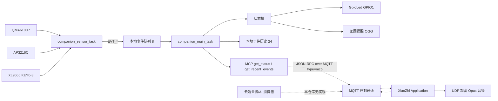

# MQTT_CLOUD_AI_AUDIT

> **2026-10-23 更新**：设备侧事件/状态 MQTT 上报与结构化命令接收/校验/执行框架已实现，并通过编译与 11 项命令协议主机测试；尚无真实 broker 联调，云端消费者与 AI 场景判断仍未实现。下方历史审查结论中“设备未发布/未接收”部分以本节为准。

审查日期：2026-10-23
审查方式：只读代码与现有日志；未编译、未烧录、未修改源码/配置/NVS。
源码：`<xiaozhi_source>`
工作区：`D:\Projects\workspace\companion`

## 1. 结论摘要

当前设备**没有把 QMA6100P、AP3216C、按键或陪伴事件发布到 MQTT**。现有 MQTT 是 XiaoZhi 语音协议承载层，只发布 hello/goodbye/listen/abort/mcp 等控制 JSON，音频走 UDP；它不承担自定义传感器遥测。云端 AI 也没有从本仓库代码中获得这些传感器数据的路径。

因此，“MQTT 实时传感器数据 → 云端 AI 场景判断 → 设备执行反馈”闭环**尚未实现**。设备侧本地闭环（传感器→事件→状态机→LED/提醒）已实现并有实机证据。

## 2. 当前架构概览

关键事实：传感器/按键/状态机与 MQTT 之间**没有任何连线**；MCP 是唯一能把本地状态暴露给云端的已实现接口，但需要云端主动调用。

## 3. 传感器与按键数据流

| 数据 | 采集与处理 | 本地事件/状态 | 是否 MQTT 上传 | 证据 |
|---|---|---|---|---|
| ALS 光照 | `ap3216c_read()` 读原始 ALS；阈值 50/60、连续 3 次去抖；未换算 lux | `EVT_DARK`/`EVT_BRIGHT`，仅记录历史，状态机不迁移 | **否** | `main/companion/companion_service.cc:237,245-269`；`ap3216c.c:104` |
| PS 接近 | 10 位原始值 0–1023；阈值 50、连续 3 次、边沿触发；无厘米换算或标定 | `EVT_HAND_NEAR`，IDLE/SLEEPY→HAPPY | **否** | `companion_service.cc:271-283`；`ap3216c.c:108-110` |
| QMA 运动 | `qma6100p_read_g()` 读三轴 g 值；拿起阈值 0.45g/保持 400ms；摇晃 1s 内 3 次符号翻转 | `EVT_PICKED_UP`/`EVT_SHAKE` → HAPPY | **否**，也不上传原始加速度 | `companion_service.cc:212-223`；`motion_detect.h:19-28` |
| 按键 | XL9555 PORT1 bit4–7，低有效；3 拍去抖；按住只触发一次 | `EVT_KEY_PRESSED`，事件参数为 0，不携带键号 | **否** | `companion_service.cc:304-311`；`atk_dnesp32s3.cc` 的 `ReadPort1` |
| 语音交互 | `companion_main_task` 轮询 Application DeviceState | `EVT_INTERACT_START/END` 直送状态机并记录历史 | 语音本身走 XiaoZhi MQTT/UDP，不是传感器遥测 | `companion_service.cc:365-381` |
| 犯困定时 | 状态机 tick，IDLE 满 3600s | `EVT_TIMER_SLEEPY` → SLEEPY → 本地 OGG 提醒 | **否** | `state_machine.c` |

事件队列容量 8，非阻塞投递，满时丢弃并计数（`event_queue.c:10,23,30-49`）。事件历史容量 24，记录类型、uptime、ALS、PS、数据有效性（`companion_event_log.h:13`；`companion_event_log.c:26-46`）。事件结构 `event_t` 只有枚举值，没有通用 payload；按键编号只出现在日志文本，不在结构化事件里。

## 4. MQTT 上行

- 配置来源：`Settings("mqtt")` 的 `endpoint/client_id/username/password/keepalive/publish_topic`（`main/protocols/mqtt_protocol.cc:69-75`）。实际 topic 值不在源码中，无法确认。
- 唯一发布函数：`MqttProtocol::SendText()` → `mqtt_->Publish(publish_topic_, text)`，未显式指定 QoS（`mqtt_protocol.cc:159-169`）；接口默认 QoS 0（`managed_components/78__esp-ml307/include/mqtt.h:14`）。
- 发布内容仅为 XiaoZhi 控制 JSON：
  - hello、goodbye（`mqtt_protocol.cc:431-454,265-269`）
  - listen start/stop/detect、abort、MCP JSON-RPC（`protocol.cc:47-84`）
- 音频上行：UDP 加密 Opus，不是 MQTT（`mqtt_protocol.cc:220-247`）。
- **没有** `Publish` 调用用于 ALS、PS、加速度、运动事件、按键事件或陪伴状态。全目录检索 `main/companion` 未见 MQTT publish；`companion_service.cc:153` 甚至把 `mqtt_state` 固定为 `"unsupported"`。

## 5. MQTT 下行

- 设备注册 `mqtt_->OnMessage` 回调（`mqtt_protocol.cc:104-137`），按 JSON `type` 分派：
  - `hello` → `ParseServerHello`，建立 UDP/AES 会话
  - `goodbye` → 关闭音频通道
  - 其他 → `Application::OnIncomingJson`
- `Application` 处理的下行类型（`application.cc:442-530`）：
  - `tts`：开始/结束/句子播报，改变 Speaking/Listening
  - `stt`：显示用户文本
  - `llm`：读取 `emotion` 并设置显示表情
  - `mcp`：交给 `McpServer::ParseMessage`，可执行 `tools/call`
  - `system`：仅支持 `reboot`
  - `alert`：播放提示音并显示状态/表情
  - `custom`：仅在 `CONFIG_RECEIVE_CUSTOM_MESSAGE` 时显示文本，不控制陪伴状态或 LED
- **没有**自定义“云端场景判断结果”消息类型，也没有 request_id/expiry/动作白名单。
- **没有显式 `Subscribe()` 调用**。设备只注册 OnMessage；下行 topic 与订阅关系取决于运行时的 broker/服务端配置，无法从本仓库确认。现有日志只能证明 MQTT 连接成功，不能证明订阅了自定义传感器/事件 topic。

## 6. XiaoZhi 云端、MQTT、MCP 的关系

- XiaoZhi 云端通过 MQTT 控制消息 + UDP 音频完成语音对话；`tts/stt/llm` 是这条链路的协议消息。
- MCP 是同一 MQTT 控制通道上的 JSON-RPC（`type:"mcp"`）；设备注册只读工具：
  - `self.companion.get_status`（`companion_service.cc:458-465`）
  - `self.companion.get_recent_events`（`companion_service.cc:467-490`）
- `get_status` 返回真实状态机快照、ALS/PS/加速度、传感器有效性、事件累计、LED 模式、音频忙等；`get_recent_events` 返回最多 24 条真实历史，最新在前。
- MCP 回调在 Application 主循环执行（`mcp_server.cc:513-565`），结果通过 `Application::SendMcpMessage` 以 `type:"mcp"` 上行（`mcp_server.cc:440-454`；`protocol.cc:81-84`）。
- **MCP 注册成功 ≠ 云端 AI 已调用**。现有日志只有 `Add tool`，没有 `tools/call` 请求/响应证据。
- XiaoZhi 语音对话能工作，不等于云端自动获得 QMA/AP/按键数据；设备没有把这些数据发布到 MQTT，云端也没有在本仓库中订阅它们。

## 7. 五类清单

### 已实现且有证据

- 本地传感器/按键采集、事件队列、状态机、事件历史。
- 拿起/摇晃/按键/手靠近触发状态迁移与 GPIO1 LED 慢闪/快闪（实机确认）。
- 60 分钟犯困提醒的软件链路与播放请求（实机日志）。
- XiaoZhi MQTT 连接、语音对话、MCP 工具注册（启动日志）。
- MCP `get_status`/`get_recent_events` 数据源为真实本地数据。

### 已实现但未验证

- MQTT 断线 60 秒重连（`mqtt_protocol.h:20`、`mqtt_protocol.cc:89-95`）。
- Wi-Fi 断线重连/重扫（`wifi_station.cc:244-259`）。
- MCP 两个工具的外部 `tools/call` 真实返回。
- 扬声器实际出声（仅到播放请求与 codec 打开）。

### 尚未实现

- 传感器、按键、陪伴状态的 MQTT 自定义遥测发布。
- 云端 MQTT 消费者、上下文存储、AI 场景判断服务。
- 结构化云端判断结果下行与设备动作执行。
- device_id/event_id/时间戳关联、离线缓存、去重、TTL、动作白名单。
- 云端直接触发陪伴状态/LED 的安全动作工具（当前 MCP 无此类工具）。

### 无法确认（需云端/外部证据）

- broker 上实际 topic、订阅关系、QoS、保留消息策略。
- `api.tenclass.net` 背后是否存在自定义业务服务消费传感器数据。
- XiaoZhi 云端 AI 是否主动调用 `self.companion.get_status/get_recent_events`。
- 云端 AI 的 prompt、上下文窗口、触发策略、结果格式。
- 是否存在其他云端消费者或规则引擎。

## 8. 当前最大阻塞点

**设备没有自定义遥测发布，仓库也没有云端消费者/AI 判断服务源码。** MQTT 只是 XiaoZhi 语音协议通道；MCP 只提供只读查询，且没有证据表明云端会主动调用。因此不能从现有代码推出“云端 AI 已感知传感器并回控设备”。

## 9. 最小改造方案（本轮不实施）

### 设备侧

1. 复用现有 MQTT 连接，增加受控发布接口（不要在 `companion` 模块另建 MQTT 客户端）。
2. 上行 topic 建议：
   - `companion/{device_id}/state`：聚合状态，5–10 秒或变化时发布，QoS 1，retain 可选。
   - `companion/{device_id}/event`：离散事件即时发布，QoS 1，携带 `event_id/seq/ts/type/data/valid`。
3. 事件 payload 复用 `companion_event_record_t`，补充 `device_id`、`event_id`、`schema_version`；按键事件增加 `key_id`。
4. 本地保留环形离线缓存（例如 32 条），重连后按 `event_id` 去重补发。
5. 新增下行 `companion/{device_id}/cmd` 订阅，消息含 `request_id/device_id/issued_at/expires_at/action/params`；设备校验 device_id、TTL、重复 request_id、动作白名单和当前状态后才执行。
6. 云端不得直接写 GPIO；只允许调用既有本地动作接口（如触发一次提醒、请求 LED 模式），由状态机决定是否接受。

### 云端侧

1. MQTT 消费者订阅 state/event，维护最近 N 条事件与当前状态。
2. 只在有意义的事件（拿起/摇晃/按键/手靠近/暗光切换/长时间无互动）触发场景判断；状态心跳只更新上下文，不调用大模型。
3. 结构化输出：`{intent, confidence, action, speech, ttl}`；低置信度只记录不动作。
4. 通过 cmd topic 下发，带 request_id 与过期时间；禁止直接控制硬件。
5. 可选复用 MCP 只读工具做补充查询，但不应把 MCP 当作遥测通道。

### 可复用/需新增

- 可复用：事件队列、事件历史、状态机快照、MCP 只读工具、LED/音频本地接口、MQTT 连接与重连。
- 需新增：设备遥测发布/下行命令处理/离线缓存；云端消费者/上下文/AI 编排；topic 与 schema；关联与安全校验。

## 10. 建议验收用例

1. 摇晃/按键/手靠近后 1 秒内，broker 收到一条 event，字段含 device_id/event_id/ts/type。
2. ALS/PS 状态按 5–10 秒或变化发布，不出现 50ms 高频刷屏。
3. 云端上下文能读取最近事件；仅事件触发 AI，心跳不触发。
4. 云端下发带 request_id/expires_at 的动作，设备校验后执行一次；重复/过期/非法动作被拒绝。
5. 断网 30 秒：本地传感器/状态机/LED 继续；重连后补发事件且不重复。
6. 外部 MCP 客户端调用两个工具，返回真实状态与事件。
7. 云端 AI 不把原始 PS 值解释为厘米，不把单次传感器事件直接等同于用户情绪。
8. 云端不可用时，设备不阻塞、不重启、不丢失本地安全逻辑。

## 11. 文档与代码不一致

- `docs/需求分析.md:149` 的 M4 写“WiFi + MQTT 数据上报”，当前代码**没有**传感器/事件 MQTT 上报。
- `docs/ARCHITECTURE.md:31` 正确描述 MQTT 为 XiaoZhi 原有语音/协议链路；与 M4 的“数据上报”表述冲突。
- 历史验收材料已注明 `mqtt_state=unsupported`、MQTT 不上报陪伴事件；以本报告和当前代码为准。
