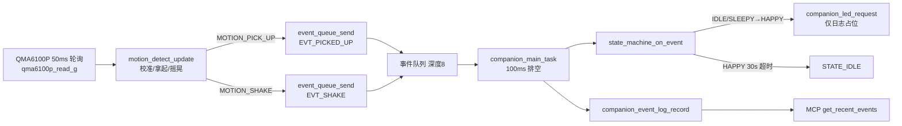
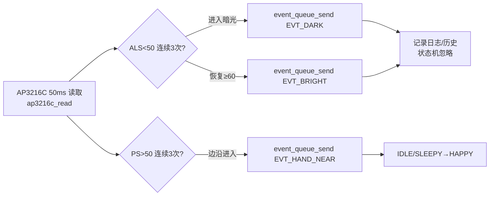
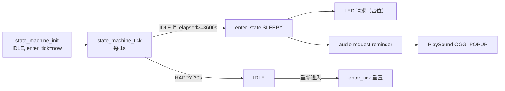

# PHASE2_CALL_GRAPH — 陪伴业务真实调用链

检查对象：`<xiaozhi_source>`
源码基线：2026-10-22 当前工作树（非 Git 仓库），交付补丁 SHA-256 `523DA580A4EA269BDD6831CBAA0E98124086539A55932CFF78E2BA8F6DE17895`。

## 1. 模块与任务

| 模块/任务 | 源文件 | 关键函数 | 行号 | 职责 |
|---|---|---|---|---|
| `companion_sensor` | `main/companion/companion_service.cc` | `companion_sensor_task` | 181 | 50ms 轮询 QMA6100P、AP3216C，生成事件 |
| `companion_main` | `main/companion/companion_service.cc` | `companion_main_task` | 323 | 100ms 排空事件队列、状态机 tick、轮询语音状态 |
| `companion_audio` | `main/companion/companion_audio.cc` | `companion_audio_task` | 19 | 仅在犯困提醒时调用 `Application::PlaySound` |
| 状态机 | `main/companion/state_machine.c` | `state_machine_on_event` / `state_machine_tick` | 107 / 191 | 5 状态迁移与 60 分钟计时 |
| 事件队列 | `main/companion/event_queue.c` | `event_queue_send` / `event_queue_recv` | 30 / 66 | 深度 8，非阻塞投递 |
| 事件历史 | `main/companion/companion_event_log.c` | `record` / `copy` | 26 / 48 | 容量 24，环形覆盖，最新在前 |
| 运动识别 | `main/companion/motion_detect.c` | `motion_detect_update` | 56 | 拿起/摇晃阈值判定 |
| QMA 驱动 | `main/companion/qma6100p.c` | `qma6100p_init` / `read_g` | 58 / 124 | I2C 0x12，8G/100Hz |
| AP3216C 驱动 | `main/companion/ap3216c.c` | `ap3216c_init` / `read` | 53 / 86 | I2C 0x1E，ALS/PS/IR |
| LED 适配 | `main/companion/companion_led.cc` | `companion_led_request` | 15 | 仅日志，不驱动 GPIO1 |
| MCP | `main/mcp_server.cc` | `AddTool` / `DoToolCall` | 305 / 513 | 工具注册与 tools/call 分发 |
| 音频服务 | `main/audio/audio_service.cc` | `PlaySound` / `IsIdle` | 523 / 622 | OGG 解码入队、播放队列空闲判断 |
| ES8388 | `main/audio/codecs/es8388_audio_codec.cc` | `EnableOutput` | 169 | 打开输出并写 0x2E–0x31 为 0dB |
| 板级初始化 | `main/boards/atk-dnesp32s3/atk_dnesp32s3.cc` | `InitializeSt7789Display` / `companion_service_start` | 98 / 199 | XL9555 P0.2 拉低使能功放；启动陪伴服务 |
| MQTT 协议 | `main/protocols/mqtt_protocol.cc` | `SendAudio` / `OpenAudioChannel` | 215 / 276 | 仅承载小智音频/协议/MCP，不上报陪伴事件 |

## 2. 运动感知链路（实际连线）

- 读取方式：`companion_sensor_task` 每轮 `vTaskDelay(50ms)`，QMA 读取在 206 行，运动识别在 211 行，事件投递在 214/217 行。
- 识别条件：`PICKUP_DZ_THRESHOLD=0.45g`、`PICKUP_HOLD_MS=400`、`SHAKE_FLIP_COUNT=3`、`SHAKE_WINDOW_MS=1000`（`main/companion/motion_detect.h:19-26`）。拿起需连续 5 次静止校准 `z_ref`；摇晃按三轴符号翻转计数，阈值 0.3g。
- 去抖/抑制：拿起锁定 400ms；摇晃 1s 窗口达到 3 次翻转后只上报一次并清零；无额外低通滤波或滑动平均。
- 事件消费：`companion_main_task` 335–338 行排空队列，逐条调用状态机并记录历史。
- 状态效果：IDLE/SLEEPY 收到 `EVT_PICKED_UP`/`EVT_SHAKE` 进入 HAPPY（`state_machine.c:121-143, 165-178`）；HAPPY 中再次活动只刷新 30s 计时（151–153 行）。
- 反馈：`enter_state(HAPPY)` 调用 `companion_led_request(COMPANION_LED_BLINK_FAST)`（`state_machine.c:76-78`），但该接口仅打印日志（`companion_led.cc:15-34`）；不调用语音、蜂鸣器或 MQTT。
- 结论：动作识别与事件链在代码层成立，主机测试覆盖算法；真实设备上的晃动 → 状态迁移 → 可见/可听反馈未闭环。

## 3. AP3216C 链路

- 读取与阈值：`companion_service.cc:231-285`；ALS 进入阈值 50、恢复阈值 60、连续 3 次；PS 阈值 50、连续 3 次、边沿触发；上电预热 10 拍（238–244 行）。
- 数据更新：快照更新在 296–317 行，受 `s_snapshot_mutex` 保护；读取失败保留最近有效值并标记 `ap_ok=false`。
- 业务使用：`EVT_HAND_NEAR` 会进入状态机；`EVT_DARK`/`EVT_BRIGHT` 只记录，不迁移（`state_machine.c` 未处理这两个事件，符合 `docs/EVENT_MODEL.md` 与 `docs/需求分析.md:85`）。
- 当前实机日志：ALS 91–95、PS 0–16，`传感器=ok/ok`；PS 未超过 50，因此 45 秒窗口内没有观察到 `EVT_HAND_NEAR`。

## 4. 状态机与事件生产/消费

| 事件 | 生产者 | 投递方式 | 消费者 | 状态机效果 |
|---|---|---|---|---|
| `EVT_PICKED_UP` | `companion_service.cc:214` | 队列 | `companion_main_task:336` | IDLE/SLEEPY→HAPPY |
| `EVT_SHAKE` | `companion_service.cc:217` | 队列 | 同上 | IDLE/SLEEPY→HAPPY |
| `EVT_DARK` | `companion_service.cc:253` | 队列 | 同上 | 无迁移，仅历史 |
| `EVT_BRIGHT` | `companion_service.cc:263` | 队列 | 同上 | 无迁移，仅历史 |
| `EVT_HAND_NEAR` | `companion_service.cc:277` | 队列 | 同上 | IDLE/SLEEPY→HAPPY |
| `EVT_INTERACT_START` | `companion_service.cc:348` | 直送状态机 | 状态机 | IDLE/HAPPY/SLEEPY→INTERACT |
| `EVT_INTERACT_END` | `companion_service.cc:356` | 直送状态机 | 状态机 | INTERACT→HAPPY |
| `EVT_TIMER_SLEEPY` | `state_machine.c:209` | 直送状态机 | 状态机 | IDLE→SLEEPY |
| `EVT_KEY_PRESSED` | **无生产者** | — | — | 代码有迁移分支，实际不可达 |
| `EVT_ALARM` | **无生产者** | — | — | 代码有迁移分支，实际不可达 |
| `EVT_NONE` | — | 队列/历史均忽略 | — | 无效果 |

状态迁移表（实际代码）：

| 当前 | 事件 | 下一状态 | 代码位置 |
|---|---|---|---|
| IDLE | PICKED_UP/SHAKE/HAND_NEAR/KEY | HAPPY | `state_machine.c:121-143` |
| IDLE | INTERACT_START | INTERACT | 134 行 |
| IDLE | TIMER_SLEEPY | SLEEPY | 129 行 |
| IDLE | ALARM | ALARM（无生产者） | 138 行 |
| HAPPY | INTERACT_START / ALARM | INTERACT / ALARM | 146-150 行 |
| HAPPY | 活动事件 | 刷新 30s 计时 | 151-153 行 |
| INTERACT | INTERACT_END / ALARM | HAPPY / ALARM | 157-162 行 |
| SLEEPY | KEY / INTERACT_START / 活动事件 / ALARM | IDLE / INTERACT / HAPPY / ALARM | 165-177 行 |
| ALARM | KEY | IDLE（无生产者触发进入） | 180-184 行 |

## 5. 语音播放链路

```mermaid
flowchart LR
    T[state_machine_tick<br/>IDLE 满 3600s] --> ES[enter_state SLEEPY]
    ES --> AR[companion_audio_request_reminder]
    AR -->|设备 idle 且音频 idle| TASK[companion_audio_task]
    TASK --> PS[Application::PlaySound<br/>OGG_POPUP]
    PS --> AS[AudioService::PlaySound<br/>解码 OGG→decode queue]
    AS --> Q[audio_playback_queue]
    Q --> CODEC[ES8388 EnableOutput/Write]
    CODEC --> SPK[喇叭]
```

- 业务触发点：仅 `state_machine.c:85`（进入 SLEEPY）调用 `companion_audio_request_reminder`；运动、靠近、ALS 事件都不触发语音。
- 请求语义：`companion_audio.cc:69-89`，检查 `Application` 设备状态为 idle、`AudioService::IsIdle()`，`s_pending.exchange` 防重复；忙时返回 false，状态机只打印警告，**不重试**。
- 播放语义：`companion_audio.cc:41` 调用 `Application::PlaySound`（`application.cc:870`），底层 `AudioService::PlaySound`（`audio_service.cc:523`）解析 OGG 并以 `wait=true` 推入解码队列；无返回值，解码/写入错误不向业务层传播。
- 共享资源：与正常小智对话共用 `AudioService`、I2S、ES8388；`IsIdle()` 只保证队列为空，不能保证扬声器实际出声或不会被随后进入的语音会话打断。
- 功放/音量：板级 `atk_dnesp32s3.cc:124` 将 XL9555 P0.2 拉低使能 MD8002A；`Es8388AudioCodec::EnableOutput`（`es8388_audio_codec.cc:169-205`）写 `0x2E–0x31` 为 0x1E（0dB）。
- 验证层级：驱动初始化有实机日志；业务调用仅有静态链路；无当前固件播放请求/实际出声证据。

## 6. 定时提醒链路

- 参数：`SLEEPY_DEFAULT_MIN 60`（`state_machine.c:16`），无编译宏覆盖；`state_machine_set_sleepy_timeout_min` 全树无调用者。
- 计时起点：`state_machine_init` 在启动时设置 `s_state_enter_tick`（95–105 行）；每次状态切换 `enter_state` 重置（57–67 行）；只在 IDLE 累计（205–210 行）。
- 周期：`companion_main_task` 每 10×100ms 调一次 `state_machine_tick`（`companion_service.cc:363-366`），即约 1s；用 tick 差值，抗调度抖动与回绕。
- 触发后：进入 SLEEPY 时请求一次提醒；SLEEPY 内 tick 不再累计，不重复提醒。
- 退出：`EVT_INTERACT_START`、拿起/摇晃/手靠近可离开 SLEEPY；`EVT_KEY_PRESSED` 分支存在但无生产者。
- 事件历史：`EVT_TIMER_SLEEPY` 由 tick 直接送入状态机，**没有** `event_queue_send`，也没有 `companion_event_log_record`，因此 MCP `get_recent_events` 不会包含犯困定时事件。
- 重启：状态机为静态变量，无 NVS 持久化，重启后从 IDLE 重新计时。
- 提醒可靠性：音频忙/设备非 idle 时请求被丢弃，状态保持 SLEEPY 且无再次提醒。

## 7. MQTT / MCP 关系

- MQTT 是 XiaoZhi 协议承载层（`mqtt_protocol.cc` 处理 hello/goodbye/音频/MCP），不包含陪伴事件上报代码。
- `get_status` 注册：`companion_service.cc:422`；字段组装：106–179 行。`mqtt_state` 固定为 `"unsupported"`（150 行），`network_connected` 来自 `WifiStation`（148–149 行）。
- `get_recent_events` 注册：`companion_service.cc:431`；读取 `companion_event_log_copy`（451–452 行），最新在前；`limit` 由 MCP Property 1–24 校验（435–437 行，`mcp_server.h:109-121`）。
- MCP 分发：`mcp_server.cc:513-565`，工具回调通过 `Application::Schedule` 投递到主事件循环（557 行），不是协议任务直接执行（与 `docs/ARCHITECTURE.md:32` 描述不一致）。
- 注册成功的实机证据：启动日志 `MCP: Add tool: self.companion.get_status/get_recent_events`；外部 `tools/call` 无证据。
